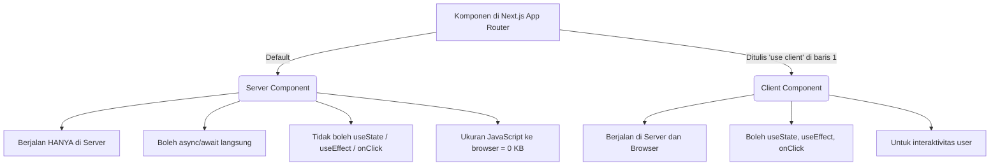

# 🚀 Panduan Lengkap Memahami Next.js dari Nol
> *Disusun khusus berdasarkan project `to-do-next` (Next.js 16, React 19, JavaScript, App Router, Tailwind CSS v4).*

---

## Daftar Isi
1. [Bedah Proses Instalasi (create-next-app)](#1-bedah-proses-instalasi-create-next-app)
2. [Peta Struktur Folder Aktual Project Kamu](#2-peta-struktur-folder-aktual-project-kamu)
3. [Penjelasan Rinci Setiap File & Folder](#3-penjelasan-rinci-setiap-file--folder)
4. [Jantungnya Next.js: Memahami Folder `src/app` (App Router)](#4-jantungnya-nextjs-memahami-folder-srcapp-app-router)
5. [Menghubungkan Mental Model: React Biasa vs Next.js](#5-menghubungkan-mental-model-react-biasa-vs-nextjs)
6. [Alur Eksekusi: Apa yang Terjadi Saat `npm run dev`?](#6-alur-eksekusi-apa-yang-terjadi-saat-npm-run-dev)
7. [Hubungan Antar-File & Layout Nesting](#7-hubungan-antar-file--layout-nesting)
8. [Tutorial Praktik Mandiri: Langkah demi Langkah](#8-tutorial-praktik-mandiri-langkah-demi-langkah)

---

## 1. Bedah Proses Instalasi (`create-next-app`)

Di terminal kamu sebelumnya, kamu menjalankan perintah:

```bash
npx create-next-app@latest .
```

* **`npx`**: Alat bawaan Node.js untuk menjalankan package tanpa harus menginstalnya secara global di komputer.
* **`create-next-app@latest`**: Generator resmi dari tim Next.js untuk menyiapkan boilerplate (pondasi awal) proyek dengan versi terbaru (dalam kasusmu: Next.js v16).
* **`.` (titik)**: Menginstruksikan Next.js untuk membuat project di folder saat ini (`to-do-next`), bukan membuat sub-folder baru.

Berikut adalah bedah pertanyaan konfigurasi yang muncul dan alasan di baliknya:

| Pertanyaan CLI | Pilihan Kamu | Penjelasan & Dampak | Kenapa Dipilih / Alternatifnya |
| :--- | :--- | :--- | :--- |
| **Would you like to use the recommended Next.js defaults?** | `No, customize settings` | Memilih untuk mengatur konfigurasi secara manual satu per satu. | **Bagus untuk belajar** karena kamu tahu persis teknologi apa saja yang dipasang ke dalam proyekmu. |
| **Would you like to use TypeScript?** | `No` (JavaScript) | Menggunakan JavaScript standar (`.js`), bukan TypeScript (`.ts`/`.tsx`). | Karena kamu belum butuh strict type checking TypeScript, file berekstensi `.js` lebih ramah untuk pemula dan tidak memunculkan error tipe data yang membingungkan. |
| **Which linter would you like to use?** | `ESLint` | Linter adalah "polisi kode" yang mengecek typo, variabel tak terpakai, atau kesalahan sintaks secara otomatis. | Standar industri di JavaScript/React agar kode tetap rapi dan bebas dari bug konyol. |
| **Would you like to use React Compiler?** | `Yes` | Fitur mutakhir React 19 yang mengoptimasi performa secara otomatis. | Di React versi lama, kita sering pusing menggunakan `useMemo` atau `useCallback` agar web tidak lambat. Dengan React Compiler, komputer yang mengurus optimasi itu untuk kita! |
| **Would you like to use Tailwind CSS?** | `Yes` | Framework CSS utilitas (kamu mendapatkan versi terbaru: Tailwind v4). | Menulis styling langsung di atribut `className` tanpa perlu bolak-balik buka file `.css` terpisah. Sangat cepat dan efisien. |
| **Would you like your code inside a `src/` directory?** | `Yes` | Menyimpan kode aplikasi utama di dalam folder `src/`. | Memisahkan kode inti web (`src/`) dari file konfigurasi luar (`package.json`, `eslint.config`, dll) agar rapi dan tidak campur aduk. |
| **Would you like to use App Router? (recommended)** | `Yes` | Sistem routing modern Next.js berbasis folder di dalam `app/`. | App Router adalah standar utama Next.js masa kini. Menggantikan "Pages Router" (sistem lama) dan mendukung fitur unggulan Server Components. |
| **Would you like to customize the import alias (`@/*` by default)?** | `No` (pakai `@/*`) | Jalan pintas saat import file. Misalnya: `@/components/Button` daripada `../../components/Button`. | Sangat menghemat waktu dan menghindarkan error *"titik dua garis miring"* yang bertingkat-tingkat (`../../../`). |
| **Would you like to include AGENTS.md?** | `Yes` | File instruksi khusus untuk asisten AI (seperti GitHub Copilot, Gemini, Cursor). | Berisi panduan bagi AI agar tidak menulis kode usang ketika membantu kamu mengoding. |

---

## 2. Peta Struktur Folder Aktual Project Kamu

Berikut adalah susunan file nyata yang ada di dalam folder proyekmu saat ini:

```text
to-do-next/
├── node_modules/             # [Otomatis] Gudang semua library eksternal (Next, React, Tailwind)
├── public/                   # [Aset Statis] Gambar, logo, icon yang bisa diakses langsung via URL
│   ├── file.svg
│   ├── globe.svg
│   ├── next.svg
│   ├── vercel.svg
│   └── window.svg
├── src/                      # [Folder Utama] Tempat seluruh kode aplikasimu tinggal
│   └── app/                  # [App Router] Setiap folder & file di sini mengatur halaman web
│       ├── favicon.ico       # Logo kecil di tab browser
│       ├── globals.css       # File CSS global & import Tailwind CSS v4
│       ├── layout.js         # Bingkai/kerangka utama website (HTML, Body, Navbar jika ada)
│       └── page.js           # Tampilan halaman utama website (localhost:3000)
├── .git/                     # [Otomatis] Catatan riwayat Git version control
├── .gitignore                # Daftar file/folder yang diabaikan Git (seperti node_modules)
├── .next/                    # [Otomatis] Hasil kompilasi Next.js (jangan disentuh)
├── AGENTS.md                 # Panduan aturan versi Next.js untuk asisten koding AI
├── eslint.config.mjs         # Konfigurasi aturan pengecekan kode (ESLint)
├── jsconfig.json             # Konfigurasi JavaScript path alias (@/*)
├── next.config.mjs           # Konfigurasi utama engine Next.js
├── package.json              # "KTP" proyek: daftar library dan perintah script
├── package-lock.json         # Catatan versi terkunci dari library yang di-install
├── postcss.config.mjs        # Plugin untuk memproses Tailwind CSS
└── README.md                 # Catatan petunjuk awal proyek
```

---

## 3. Penjelasan Rinci Setiap File & Folder

Berikut panduan status setiap elemen: apa fungsinya, kenapa ada, dan apakah aman untuk diubah.

---

### Folder: `node_modules/`
* **Apa ini:** Folder raksasa yang menampung file kode dari semua library yang diunduh (Next.js, React, Tailwind, ESLint).
* **Fungsi:** Menyediakan mesin di balik layar agar aplikasi bisa berjalan.
* **Kenapa ada:** Dibuat otomatis oleh `npm` ketika membaca `dependencies` di `package.json`.
* **Kapan digunakan:** Tidak pernah dibuka atau diedit manual.
* **Status:** ⚠️ **JANGAN DIUBAH!** Jika terhapus, cukup jalankan `npm install`.

---

### Folder: `public/`
* **Apa ini:** Lemari penyimpanan file statis (gambar, font, audio, ikon).
* **Fungsi:** File apa pun di dalam folder ini bisa langsung diakses oleh browser tanpa perlu di-import lewat JavaScript.
* **Kenapa ada:** Memisahkan aset media mentah dari logika kode.
* **Kapan digunakan:** Saat kamu ingin menaruh logo web (`logo.png`), foto profil, atau ilustrasi.
* **Contoh:** Jika ada file [public/next.svg](file:///Users/najmiraihan/Kuliah/to-do-next/public/next.svg), kamu bisa langsung membukanya di browser via `http://localhost:3000/next.svg` atau di kode via `<Image src="/next.svg" />`.
* **Status:**  **Bebas ditambah/diubah/dihapus.**

---

### Folder: `src/`
* **Apa ini:** Singkatan dari *Source* (sumber kode).
* **Fungsi:** Membungkus seluruh logika pembuatan web.
* **Kenapa ada:** Menjaga akar proyek (root folder) tetap bersih. File konfigurasi berada di luar, kode kreatifmu berada di dalam.
* **Kapan digunakan:** 95% aktivitas kodingmu akan berada di dalam folder ini.
* **Status:**  **Area kerja utamamu.**

---

### Folder: `src/app/`
* **Apa ini:** Inti dari sistem App Router Next.js.
* **Fungsi:** Mengubah struktur folder menjadi URL halaman secara otomatis (*File-system based routing*).
* **Kenapa ada:** Di Next.js, kamu tidak perlu menginstall `react-router-dom` atau menulis rute manual. Folder = URL.
* **Kapan digunakan:** Setiap kali ingin membuat halaman baru, layout baru, atau modal pop-up.
* **Status:**  **Folder paling krusial yang akan sering kamu edit.**

---

### File: `package.json`
* **Apa ini:** KTP dan buku resep dari proyek Node.js / Next.js.
* **Fungsi:**
  1. Mencatat nama dan versi proyek.
  2. Menyimpan daftar script perintah (`npm run dev`, `npm run build`).
  3. Mencatat library yang terpasang (`dependencies` & `devDependencies`).
* **Kenapa ada:** Agar komputer atau developer lain tahu library apa saja yang dibutuhkan untuk menjalankan aplikasi ini.
* **Kapan digunakan:** Saat ingin menambahkan library baru (misal: Lucide Icon, Axios) atau melihat perintah script.
* **Status:** ⚠️ **Hati-hati saat mengubah.** Jangan ubah sembarangan kecuali paham sintaks JSON-nya.

---

### File: `next.config.mjs`
* **Apa ini:** File konfigurasi tingkat tinggi untuk server Next.js.
* **Fungsi:** Mengatur perilaku khusus Next.js, seperti mengizinkan domain gambar dari luar, mengatur redirect URL, atau mengaktifkan fitur experimental (seperti `reactCompiler: true`).
* **Kenapa ada:** Disediakan jika aplikasi butuh kustomisasi server yang tidak tersedia secara default.
* **Kapan digunakan:** Ketika kamu butuh mengambil gambar dari internet (misal: Unsplash/Cloudinary) atau mengatur konfigurasi build lanjutan.
* **Status:** ⚠️ **Jarang diubah oleh pemula.**

---

### File: `jsconfig.json`
* **Apa ini:** Konfigurasi pemahaman JavaScript untuk teks editor (VS Code / IDE).
* **Fungsi:** Memberitahu editor bahwa `@/*` adalah jalan pintas menuju `./src/*`.
* **Kenapa ada:** Agar saat kamu mengetik `import Button from "@/components/Button"`, teks editor langsung tahu lokasinya dan memberi fitur *auto-complete*.
* **Kapan digunakan:** Hanya jika kamu ingin membuat alias baru (misal `~/*`).
* **Status:** 🔒 **Biarkan seperti default.**

---

### File: `eslint.config.mjs` & `postcss.config.mjs`
* **Apa ini:** Konfigurasi untuk linter (ESLint) dan CSS preprocessor (PostCSS).
* **Fungsi:** `postcss.config.mjs` bertugas menjembatani Tailwind CSS v4 agar browser memahami CSS modern yang kita tulis.
* **Status:** 🔒 **Biarkan seperti default.**

---

### File: `AGENTS.md`
* **Apa ini:** Dokumen instruksi bagi AI coding assistant.
* **Fungsi:** Mengingatkan AI bahwa Next.js yang kamu pakai memiliki versi mutakhir (Next.js 16) dengan beberapa perubahan API, sehingga AI tidak memberikan kode usang.
* **Status:** 🔒 **Biarkan apa adanya.**

---

## 4. Jantungnya Next.js: Memahami Folder `src/app` (App Router)

### Prinsip Utama: File-System Based Routing
Di React biasa, kamu harus memasang `react-router-dom` dan mendefinisikan rute seperti:
```jsx
// React Biasa (Lama & Ribet)
<Routes>
  <Route path="/" element={<Home />} />
  <Route path="/about" element={<About />} />
</Routes>
```
Di Next.js App Router, **kamu tidak perlu menulis rute manual sama sekali!**
Cukup buat folder, lalu taruh file bernama khusus di dalamnya.

---

### Nama-Nama File Khusus (*Special File Conventions*)

Next.js mengenali nama-nama file spesifik di dalam folder `src/app/`. Nama-nama ini memiliki tugas sakti:

| Nama File | Peran & Fungsinya | Kapan Digunakan? |
| :--- | :--- | :--- |
| **`page.js`** | **Tampilan Halaman Utama.** File ini adalah UI yang ditampilkan ke user ketika mengunjungi URL folder tersebut. Tanpa file ini, URL tidak bisa diakses publik. | Wajib ada di setiap rute yang ingin dibuka di browser. |
| **`layout.js`** | **Kerangka/Bingkai Bersama.** UI pembungkus yang tidak akan di-refresh (*persisten*) ketika user berpindah halaman di dalam folder yang sama (contoh: Navbar, Footer, Sidebar). | Digunakan untuk header/footer yang tidak boleh hilang saat pindah halaman. |
| **`loading.js`** | **Tampilan Loading Otomatis.** Ditampilkan secara instan saat data halaman sedang diambil di server. Menggunakan teknologi React Suspense di baliknya. | Saat halaman butuh waktu beberapa detik untuk fetch data dari database/API. |
| **`error.js`** | **Penangkap Error (*Error Boundary*).** Jika terjadi crash/bug di halaman, file ini yang muncul agar seluruh web tidak blank putih. | Menampilkan pesan "Oops, terjadi kesalahan" dengan tombol "Coba Lagi". |
| **`not-found.js`**| **Halaman 404 Kustom.** Ditampilkan jika URL yang dicari user tidak ditemukan. | Mengganti tampilan 404 default browser menjadi desain webmu sendiri. |
| **`route.js`** | **API Endpoint (Backend).** Menggantikan `page.js` jika folder tersebut bukan halaman web, melainkan API JSON (GET, POST, PUT, DELETE). | Saat ingin membuat REST API di dalam proyek Next.js tanpa perlu Express.js. |

>  **Aturan Emas:** Sebuah folder **tidak boleh** memiliki `page.js` dan `route.js` sekaligus secara bersamaan. Folder ditujukan untuk halaman UI **atau** untuk endpoint data API.

---

### Pola Folder: Reguler, Dynamic, dan Route Group

Mari kita lihat 3 macam bentuk folder di App Router:

#### 1. Folder Biasa (Static Route)
* Struktur: `src/app/about/page.js`
* URL Hasil: `http://localhost:3000/about`

#### 2. Dynamic Route: `[namaParam]`
Bagaimana jika kamu membuat web blog atau toko online dengan ribuan barang? Tentu kamu tidak mungkin membuat folder satu per satu (`/produk/1`, `/produk/2`).
* Struktur: `src/app/produk/[id]/page.js`
* URL Hasil:
  * `http://localhost:3000/produk/sepatu`
  * `http://localhost:3000/produk/buku-react`
* Nilai di dalam kurung siku (`id`) akan dikirimkan sebagai props ke komponen tersebut.

#### 3. Route Group: `(namaGrup)`
Kadang kamu ingin mengelompokkan folder secara internal tanpa mempengaruhi URL di browser. Gunakan kurung biasa `()`.
* Struktur: `src/app/(auth)/login/page.js`
* URL Hasil: `http://localhost:3000/login` *(nama `(auth)` diabaikan oleh URL!)*
* **Fungsi:** Sangat berguna jika grup `(auth)` butuh `layout.js` yang berbeda (tanpa navbar) dibanding grup utama web.

---

### Contoh Struktur Lengkap & Peta URL-nya

Perhatikan contoh struktur folder berikut:

```text
src/app/
├── layout.js              (1) Layout Akar (seluruh web)
├── page.js                (2) Halaman Beranda (/)
├── dashboard/
│   ├── layout.js          (3) Sub-Layout khusus Dashboard (misal: Sidebar)
│   └── page.js            (4) Halaman Dashboard (/dashboard)
└── users/
    └── [id]/
        └── page.js        (5) Halaman Detail User (/users/123)
```

**Ketika user mengunjungi URL:**

1. **User membuka `/`**
   * Yang jalan: `(1) layout.js` membungkus `(2) page.js`.
2. **User membuka `/dashboard`**
   * Yang jalan: `(1) layout.js` membungkus `(3) dashboard/layout.js`, yang kemudian membungkus `(4) dashboard/page.js`. *(Inilah yang disebut Nested Layout! Sidebar dashboard tetap ada, navbar luar tetap ada).*
3. **User membuka `/users/budi`**
   * Yang jalan: `(1) layout.js` membungkus `(5) users/[id]/page.js`, di mana komponen menerima parameter `{ params: { id: 'budi' } }`.

---

## 5. Menghubungkan Mental Model: React Biasa vs Next.js

Karena kamu sudah punya dasar React, mari kita bedah perbedaan cara berpikirnya:

### 1. Di mana kode dieksekusi?
* **Di React biasa (Vite / CRA):**
  Browser mengunduh file HTML kosong (`<div id="root"></div>`), lalu mengunduh bundle JavaScript besar. Browser kamu yang bekerja keras mengubah JavaScript menjadi elemen HTML (Client-Side Rendering / CSR).
* **Di Next.js:**
  Server Next.js merender komponen React menjadi HTML matang terlebih dahulu, lalu mengirim HTML tersebut ke browser (Server-Side Rendering / SSR). Halaman langsung terlihat seketika oleh user!

---

### 2. Server Component vs Client Component (Konsep Paling Penting!)

Secara default di App Router, **semua komponen adalah Server Component.**



#### Komparasi Praktis:

| Kebutuhan | React Biasa | Next.js Server Component | Next.js Client Component |
| :--- | :--- | :--- | :--- |
| **Ambil Data (Fetch)** | Wajib di dalam `useEffect()` + `useState()` untuk tampung data loading. | Cukup pakai fungsi `async/await` biasa langsung di dalam komponen! | Sama seperti React biasa (atau kirim data dari Server Component lewat props). |
| **Tombol Interaktif (onClick)** | Langsung pasang `onClick={handleClick}` | ❌ **Error!** Server tidak mengenal klik mouse. |  Wajib pasang `"use client"` di baris paling atas file. |
| **State (`useState`)** | Bebas dipakai di mana saja. | ❌ Tidak bisa. Server tidak menyimpan interaksi browser. |  Bisa dipakai seperti biasa. |

#### Makna Sebenarnya dari `"use client"`:
Banyak pemula salah paham mengira `"use client"` berarti *"kode ini hanya jalan di browser"*.
**Bukan!** `"use client"` adalah penanda batas (*boundary*). Komponen tersebut tetap di-render awal di server menjadi HTML, tetapi kodenya juga dikirimkan ke browser agar bisa dihidupkan interaktivitasnya (*hydration*).

---

## 6. Alur Eksekusi: Apa yang Terjadi Saat `npm run dev`?

Saat kamu menjalankan `npm run dev` di terminal dan membuka `http://localhost:3000`, inilah alur nyata yang terjadi:

```text
[1] Browser meminta halaman (Request: GET /)
                         ↓
[2] Next.js Node.js Server menerima permintaan
                         ↓
[3] Next.js mencari folder yang cocok di src/app/ (yaitu root '/')
                         ↓
[4] Eksekusi Server Components:
    • src/app/layout.js dieksekusi di server
    • src/app/page.js dieksekusi di server
    • Jika ada fetch data / database query, dijalankan di sini
                         ↓
[5] Server merakit HTML utuh:
    <html>
      <body> (layout)
         <main>Konten dari page.js</main>
      </body>
    </html>
                         ↓
[6] Server mengirim HTML + Payload Interaktif ke Browser
                         ↓
[7] Browser menampilkan HTML (User langsung melihat tampilan web secara cepat!)
                         ↓
[8] Proses "Hydration":
    Browser mengaitkan event handler (onClick, useState) pada tombol-tombol yang membutuhkan
```

*Keunggulan alur ini:* Web terasa sangat cepat dibuka pertama kali, bagus untuk SEO Google, dan hemat baterai HP user karena pemrosesan berat terjadi di server.

---

## 7. Hubungan Antar-File & Layout Nesting

Mari kita intip file [src/app/layout.js](file:///Users/najmiraihan/Kuliah/to-do-next/src/app/layout.js) milikmu saat ini:

```javascript
// src/app/layout.js
export default function RootLayout({ children }) {
  return (
    <html lang="en">
      <body className="min-h-full flex flex-col">
        {children} {/* <-- DI SINI KONTEN HALAMAN AKAN DIMASUKKAN */}
      </body>
    </html>
  );
}
```

Dan file [src/app/page.js](file:///Users/najmiraihan/Kuliah/to-do-next/src/app/page.js):

```javascript
// src/app/page.js
export default function Home() {
  return (
    <main>
      <h1>Selamat Datang di Halaman Home!</h1>
    </main>
  );
}
```

### Bagaimana keduanya bekerja sama?
Komponen `Home` dari `page.js` akan otomatis dioper sebagai properti **`children`** ke dalam `RootLayout` di `layout.js`!

Jadi secara otomatis hasil akhirnya adalah:
```html
<html lang="en">
  <body className="min-h-full flex flex-col">
    <!-- Ini adalah isi dari page.js yang disisipkan: -->
    <main>
      <h1>Selamat Datang di Halaman Home!</h1>
    </main>
  </body>
</html>
```

### Jika kamu membuat `src/app/about/page.js`:
1. URL di browser menjadi: `http://localhost:3000/about`.
2. Next.js secara cerdas melihat folder `src/app/about` dan membaca `page.js` di dalamnya.
3. Karena folder `about` tidak punya `layout.js` sendiri, Next.js otomatis menggunakan `layout.js` dari folder induknya (`src/app/layout.js`).
4. Komponen halaman About disisipkan sebagai `{children}` ke dalam RootLayout.

---

## 8. Tutorial Praktik Mandiri: Langkah demi Langkah

Mari kita latih mental modelmu dengan 5 eksperimen kecil bertahap.

---

### Latihan 1: Membersihkan Tampilan Home (`src/app/page.js`)
File bawaan Next.js sangat panjang karena berisi demo Vercel. Mari kita ganti dengan kode yang sangat bersih.

Edit file [src/app/page.js](file:///Users/najmiraihan/Kuliah/to-do-next/src/app/page.js) menjadi:

```javascript
import Link from "next/link";

export default function Home() {
  return (
    <main className="p-8 max-w-xl mx-auto space-y-4">
      <h1 className="text-3xl font-bold text-blue-600">Halo Next.js! 👋</h1>
      <p className="text-gray-600">
        Ini adalah halaman utama (Home) yang dirender di server.
      </p>
      <div className="pt-4">
        <Link 
          href="/about" 
          className="bg-blue-500 hover:bg-blue-600 text-white px-4 py-2 rounded-lg transition"
        >
          Pergi ke Halaman Tentang Kami →
        </Link>
      </div>
    </main>
  );
}
```

> **Catatan Penting:** Di Next.js kita menggunakan komponen `<Link href="...">` dari `"next/link"`, bukan tag `<a href="...">` biasa. Tujuannya agar navigasi halaman berpindah secara mulus instan tanpa reload browser (*Single Page Navigation*).

---

### Latihan 2: Membuat Halaman Baru `/about`
Buat folder baru bernama `about` di dalam `src/app/`, lalu buat file `page.js` di dalamnya:

File: `src/app/about/page.js`
```javascript
import Link from "next/link";

export default function AboutPage() {
  return (
    <main className="p-8 max-w-xl mx-auto space-y-4">
      <h1 className="text-3xl font-bold text-green-600">Halaman Tentang Kami 📖</h1>
      <p className="text-gray-600">
        Halaman ini dibuat hanya dengan membuat folder <code className="bg-gray-100 px-1 py-0.5 rounded">src/app/about/page.js</code>!
      </p>
      <Link href="/" className="text-blue-500 hover:underline">
        ← Kembali ke Beranda
      </Link>
    </main>
  );
}
```
*Buka `http://localhost:3000/about` di browsermu dan saksikan hasilnya!*

---

### Latihan 3: Membuat Komponen Reusable (`Navbar`)
Buat folder baru `src/components/`, lalu buat file `Navbar.js`:

File: `src/components/Navbar.js`
```javascript
import Link from "next/link";

export default function Navbar() {
  return (
    <nav className="border-b border-gray-200 px-8 py-4 flex justify-between items-center bg-white shadow-sm">
      <span className="font-bold text-lg text-gray-800">To-Do Next 📝</span>
      <div className="space-x-4 text-sm font-medium">
        <Link href="/" className="text-gray-600 hover:text-blue-600">Home</Link>
        <Link href="/about" className="text-gray-600 hover:text-blue-600">About</Link>
      </div>
    </nav>
  );
}
```

Sekarang, pasang `Navbar` ini ke [src/app/layout.js](file:///Users/najmiraihan/Kuliah/to-do-next/src/app/layout.js) tepat di atas `{children}`:

```javascript
import Navbar from "@/components/Navbar"; // Menggunakan alias @/*
import "./globals.css";

export const metadata = {
  title: "Belajar Next.js",
  description: "Aplikasi latihan Next.js",
};

export default function RootLayout({ children }) {
  return (
    <html lang="id">
      <body className="min-h-screen bg-gray-50 flex flex-col">
        <Navbar />
        <div className="flex-1">{children}</div>
      </body>
    </html>
  );
}
```
*Hasilnya:* Navbar akan otomatis muncul di halaman Home maupun About tanpa perlu kamu panggil berulang-ulang!

---

### Latihan 4: Membuat Client Component Interaktif (`useState`)
Sekarang saatnya melihat kapan kita wajib menggunakan `"use client"`. Kita akan membuat komponen Counter sederhana.

Buat file: `src/components/Counter.js`
```javascript
"use client"; // WAJIB! Menandakan komponen ini interaktif dan menggunakan state di browser

import { useState } from "react";

export default function Counter() {
  const [count, setCount] = useState(0);

  return (
    <div className="p-4 border border-gray-200 rounded-xl bg-white shadow-sm inline-block space-y-2">
      <p className="font-semibold text-gray-700">Penghitung Klik: {count}</p>
      <div className="space-x-2">
        <button
          onClick={() => setCount(count + 1)}
          className="bg-green-500 hover:bg-green-600 text-white px-3 py-1 rounded-md text-sm font-medium"
        >
          Tambah (+)
        </button>
        <button
          onClick={() => setCount(0)}
          className="bg-gray-200 hover:bg-gray-300 text-gray-700 px-3 py-1 rounded-md text-sm font-medium"
        >
          Reset
        </button>
      </div>
    </div>
  );
}
```

Kamu bisa memanggil komponen `<Counter />` ini di dalam `src/app/page.js` seperti komponen React biasa!

---

### Latihan 5: Dynamic Route (`src/app/todos/[id]/page.js`)
Buat folder `src/app/todos/[id]/` dan file `page.js` di dalamnya:

File: `src/app/todos/[id]/page.js`
```javascript
import Link from "next/link";

// Komponen Server Component menerima parameter 'params' secara asinkron di Next.js terbaru
export default async function TodoDetailPage({ params }) {
  const { id } = await params;

  return (
    <main className="p-8 max-w-xl mx-auto space-y-4">
      <h1 className="text-2xl font-bold text-purple-600">
        Detail Tugas ID: #{id}
      </h1>
      <p className="text-gray-600">
        Halaman ini dibuat otomatis dengan Dynamic Route <code className="bg-gray-100 px-1 py-0.5 rounded">[id]</code>.
      </p>
      <Link href="/" className="text-blue-500 hover:underline">
        ← Kembali ke Home
      </Link>
    </main>
  );
}
```
*Coba buka di browser:*
* `http://localhost:3000/todos/belajar-next`
* `http://localhost:3000/todos/100`

Teks judul akan berganti otomatis sesuai URL yang kamu ketikkan!

---

## Ringkasan Mental Model untuk Kamu Ingat Selamanya

1. **Folder adalah URL**: Ingin halaman `/kontak`? Buat folder `src/app/kontak/page.js`.
2. **Server Pertama Kali**: Semua komponen di Next.js secara default berjalan di server. Sangat cepat dan aman.
3. **Kapan butuh `"use client"`?**: Hanya ketika komponenmu butuh interaksi browser (`onClick`, `onChange`, `useState`, `useEffect`, `localStorage`).
4. **`layout.js` adalah bingkai**: Membungkus semua halaman di dalamnya dan tidak pernah reload saat berpindah rute.
5. **Path Alias `@/`**: Gunakan `@/components/...` untuk mengambil file dari folder `src/`.
