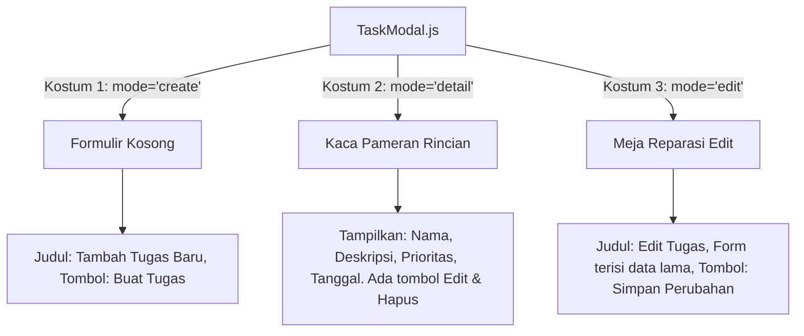

# 🚀 Petualangan Lanjut: Memahami Aplikasi To-Do List Lengkap
> *Panduan belajar Next.js lanjutan, dijelaskan secara detail dan super ramah seperti mengobrol dengan anak kelas 3 SD!*

---

## Daftar Isi Petualangan
1. [Peta Rahasia: Struktur Rumah Aplikasi Kita Saat Ini](#1-peta-rahasia-struktur-rumah-aplikasi-kita-saat-ini)
2. [Mantra Sakti CRUD: 4 Jurus Utama Mengelola Tugas](#2-mantra-sakti-crud-4-jurus-utama-mengelola-tugas)
3. [Robot Serbaguna: 1 Modal dengan 3 Kostum (Create, Edit, Detail)](#3-robot-serbaguna-1-modal-dengan-3-kostum-create-edit-detail)
4. [Celengan Rahasia: Bagaimana LocalStorage Bekerja di Next.js](#4-celengan-rahasia-bagaimana-localstorage-bekerja-di-nextjs)
5. [Misteri Layar Gelap: Cerita Teks yang Sempat Hilang di Dark Mode](#5-misteri-layar-gelap-cerita-teks-yang-sempat-hilang-di-dark-mode)
6. [Satpam Keyboard: Tombol Escape Penutup Modal](#6-satpam-keyboard-tombol-escape-penutup-modal)
7. [Bedah Kode Nyata Baris demi Baris](#7-bedah-kode-nyata-baris-demi-baris)

---

## 1. Peta Rahasia: Struktur Rumah Aplikasi Kita Saat Ini

Aplikasi To-Do List yang baru saja kita buat bersama-sama ibarat sebuah rumah bertingkat yang rapi:

```text
src/
├── app/
│   ├── layout.js          # Atap & Tembok Rumah: Menyediakan kerangka utama dan Navbar
│   ├── page.js            # Ruang Tamu Utama (Server Component): Menyambut pengunjung
│   ├── about/page.js      # Ruang Baca: Halaman informasi tentang aplikasi
│   └── globals.css        # Cat Rumah: Warna tema terang dan gelap (Tailwind CSS)
└── components/
    ├── Navbar.js          # Pintu & Papan Petunjuk: Menunjuk ke halaman Tugas atau About
    ├── TodoApp.js         # Meja Belajar Utama: Otak yang mengatur daftar tugas (Client Component)
    └── TaskModal.js       # Kotak Ajaib Popup: Jendela pop-up untuk Create, Edit, dan Detail
```

### Siapa Bekerja Sama dengan Siapa?
1. **`page.js`** adalah tuan rumah yang tenang (*Server Component*). Dia tidak banyak tingkah, tugasnya hanya menyiapkan piring dan menyajikan komponen **`TodoApp.js`** ke layar.
2. **`TodoApp.js`** adalah anak cerdas yang memegang pensil dan buku (*Client Component*). Dia mencatat setiap kali kamu menambah, menyortir, atau menghapus tugas.
3. **`TaskModal.js`** adalah asisten kecil yang melompat keluar ke tengah layar (*Popup Modal*) saat kamu ingin menulis tugas baru atau mengedit catatan tugas lama.

---

## 2. Mantra Sakti CRUD: 4 Jurus Utama Mengelola Tugas

Di dunia komputer dan pemrograman, ada sebuah mantra terkenal bernama **CRUD**.
Setiap aplikasi hebat di dunia (mulai dari WhatsApp, Instagram, sampai To-Do List kita) pasti menggunakan 4 jurus ini:

| Huruf | Nama Keren | Artinya untuk Anak SD | Contoh Nyata di Aplikasi Kita |
| :---: | :--- | :--- | :--- |
| **C** | **Create** | **Membuat** hal baru | Menekan tombol `+ Tambah Tugas Baru` lalu mengisi nama tugas. |
| **R** | **Read** | **Melihat** dan membaca | Melihat daftar tugas di layar dan memfilter tab *Semua*, *Aktif*, atau *Selesai*. |
| **U** | **Update** | **Mengubah** yang sudah ada | Mencentang kotak selesai atau mengubah judul dan deskripsi lewat popup edit. |
| **D** | **Delete** | **Menghapus** yang tidak perlu | Menekan tombol silang `✕` atau tombol `Hapus yang selesai`. |

---

## 3. Robot Serbaguna: 1 Modal dengan 3 Kostum (Create, Edit, Detail)

Kemarin kamu bertanya: *"Kenapa form Create, Edit, dan Detail harus sama?"*

Jawabannya: **Itu cara kerja yang sangat pintar!**
Daripada kita membuat 3 form yang berbeda-beda dan membuat kode jadi berantakan, kita membuat **1 komponen modal serbaguna** bernama `TaskModal.js`.

Bayangkan `TaskModal.js` ini seperti **seorang robot aktor yang memiliki 3 kostum berbeda**:



### 1. Kostum Pertama: Mode `create` (Tambah Tugas Baru)
* **Kapan muncul:** Saat kamu menekan tombol besar `+ Tambah Tugas Baru` di atas.
* **Isi di dalamnya:** Semua kotak isian (nama tugas, deskripsi, prioritas) masih kosong dan bersih.
* **Tombolnya:** *Batal* dan *Buat Tugas*.

### 2. Kostum Kedua: Mode `detail` (Melihat Rincian)
* **Kapan muncul:** Saat kamu mengklik tulisan tugas atau tombol *Detail*.
* **Isi di dalamnya:** Robot tidak menampilkan kotak isian yang bisa diedit, melainkan menampilkan pameran rapi:
  * Nama tugas dengan huruf tebal.
  * Deskripsi catatan lengkap yang bisa dibaca santai.
  * Lencana prioritas (*Penting* atau *Biasa*).
  * Tanggal pembuatan tugas.
* **Tombolnya:** *Tutup*, *Hapus Tugas Ini*, dan tombol sakti *Edit Tugas* (yang langsung menyuruh robot berganti ke kostum ketiga!).

### 3. Kostum Ketiga: Mode `edit` (Memperbaiki Tugas)
* **Kapan muncul:** Saat kamu menekan tombol *Edit* di kartu tugas, atau saat kamu menekan tombol *Edit Tugas* dari dalam mode detail.
* **Isi di dalamnya:** Kotak isian sudah otomatis terisi tulisan tugasmu yang lama, sehingga kamu tinggal mengubah huruf yang salah atau menambah deskripsi baru.
* **Tombolnya:** *Batal* dan *Simpan Perubahan*.

---

## 4. Celengan Rahasia: Bagaimana LocalStorage Bekerja di Next.js

Bayangkan kamu punya celengan rahasia di bawah kasur kamarmu. Celengan itu bernama **LocalStorage**.
Setiap kali kamu menulis tugas baru, komputermu memasukkan kertas catatan ke dalam celengan tersebut.

### Kenapa Data Tidak Hilang Saat Halaman di-Refresh?
Karena sebelum browser memuat ulang halaman, catatanmu sudah tersimpan aman di celengan komputermu!

```javascript
// Membuka celengan dan membaca isinya saat web baru dibuka:
const dataTersimpan = localStorage.getItem("to-do-next-tasks");

// Memasukkan catatan baru ke celengan:
localStorage.setItem("to-do-next-tasks", JSON.stringify(tasks));
```

### Cerita Seru: Masalah "Lampu Kamar Belum Dinyalakan" (Hydration Mismatch)
Di Next.js, ada aturan unik:
1. Server Next.js bertugas merakit halaman pertama kali di tempat yang jauh.
2. Server itu **tidak bisa melihat celengan di bawah kasur laptopmu** (karena celengan itu ada di browsermu, bukan di server!).
3. Kalau Server mencoba membaca celengan yang tidak ada, web akan bingung dan berteriak error: *"Loh, data di server kok beda dengan data di browsermu!"*.

**Cara Pintar Kita Mengatasinya:**
Kita memakai mantra `isLoaded` dan `useEffect`:
```javascript
const [isLoaded, setIsLoaded] = useState(false);

useEffect(() => {
  // Kode di dalam sini HANYA berjalan setelah web sampai di browsermu!
  // Seperti menunggu lampu kamar dinyalakan baru membuka celengan.
  const saved = localStorage.getItem("to-do-next-tasks");
  if (saved) {
    setTasks(JSON.parse(saved));
  }
  setIsLoaded(true);
}, []);
```
Dengan cara ini, aplikasi kita berjalan mulus tanpa error sedikit pun!

---

## 5. Misteri Layar Gelap: Cerita Teks yang Sempat Hilang di Dark Mode

Tadi sore, kita sempat menemukan misteri kecil yang menarik:
Ketika laptopmu menggunakan mode gelap (*dark mode*), kotak input tiba-tiba berubah menjadi putih dan tulisan yang kamu ketik tidak kelihatan sama sekali!

### Kenapa Itu Bisa Terjadi?
Ibarat kamu sedang menulis surat menggunakan kapur putih di atas papan tulis hitam:
1. Papan tulisnya berwarna hitam pekat (`dark:bg-slate-900`).
2. Kapurnya berwarna putih terang (`dark:text-slate-100`).
3. Tiba-tiba, saat jarimu menyentuh papan tulis (*focus*), ada perintah nakal `focus:bg-white` yang mengganti warna papan tulis menjadi putih bersih!
4. Hasilnya: **Tulisan kapur putih berada di atas papan tulis putih.** Tentu saja matamu tidak bisa melihat apa-apa!

### Cara Kita Memperbaikinya:
Kita memasang pengaman warna di [src/components/TodoApp.js](file:///Users/najmiraihan/Kuliah/to-do-next/src/components/TodoApp.js) dan [src/components/TaskModal.js](file:///Users/najmiraihan/Kuliah/to-do-next/src/components/TaskModal.js):
```html
<!-- Kita beritahu Tailwind: -->
<!-- Saat diklik di mode gelap, latarnya HARUS TETAP GELAP (dark:focus:bg-slate-950) -->
<input
  class="... focus:bg-white dark:bg-slate-900 dark:text-slate-100 dark:focus:bg-slate-950"
/>
```
Sekarang, papan tulisnya tetap hitam legam dan kapur putihnya bersinar terang benderang. Masalah selesai!

---

## 6. Satpam Keyboard: Tombol Escape Penutup Modal

Pernahkah kamu merasa kesal saat ada popup muncul di layar komputer, tapi kamu bingung cara menutupnya?

Di aplikasi kita, ada satpam pintar yang menjaga keyboard komputermu:
```javascript
useEffect(() => {
  const handleKeyDown = (e) => {
    // Kalau pengguna menekan tombol Escape di ujung kiri atas keyboard:
    if (e.key === "Escape" && isOpen) {
      onClose(); // Tutup popup seketika!
    }
  };
  window.addEventListener("keydown", handleKeyDown);
  return () => window.removeEventListener("keydown", handleKeyDown);
}, [isOpen, onClose]);
```

Kapan pun popup terbuka, kamu cukup memencet tombol **`Esc` (Escape)** di ujung kiri atas keyboardmu, dan popup akan langsung menghilang dengan sopan. Ini membuat aplikasi kita terasa sangat nyaman dan profesional!

---

## 7. Bedah Kode Nyata Baris demi Baris

Mari kita lihat potongan kode utama di dalam [src/components/TodoApp.js](file:///Users/najmiraihan/Kuliah/to-do-next/src/components/TodoApp.js) yang mengatur modal ajaib kita:

```javascript
// 1. Ini wadah untuk mencatat apakah modal sedang buka, modenya apa, dan tugas mana yang dipilih:
const [modalState, setModalState] = useState({
  isOpen: false,     // Apakah jendela popup sedang terbuka? (true / false)
  mode: "create",    // Sedang pakai kostum apa? ("create", "edit", atau "detail")
  task: null,        // Tugas mana yang sedang dipajang?
});

// 2. Fungsi saat tombol "+ Tambah Tugas Baru" ditekan:
const openCreateModal = () => {
  setModalState({
    isOpen: true,
    mode: "create",
    task: null,
  });
};

// 3. Fungsi saat kartu tugas diklik untuk melihat detail:
const openDetailModal = (task) => {
  setModalState({
    isOpen: true,
    mode: "detail",
    task: task,
  });
};

// 4. Fungsi saat tombol "Edit" ditekan:
const openEditModal = (task) => {
  setModalState({
    isOpen: true,
    mode: "edit",
    task: task,
  });
};
```

Lihat betapa rapi dan sederhananya!
Hanya dengan 1 state `modalState`, kita bisa mengendalikan seluruh proses Create, Edit, dan Detail tanpa perlu membuat file baru yang berantakan.

---

## Rangkuman Pelajaran Hari Ini

1. **CRUD** adalah 4 jurus utama aplikasi: Create (buat), Read (baca), Update (ubah), dan Delete (hapus).
2. **TaskModal** adalah robot serbaguna yang bisa memakai 3 kostum: form pendaftaran kosong (`create`), meja pameran rincian (`detail`), dan meja reparasi data (`edit`).
3. **LocalStorage** adalah celengan browser tempat menyimpan catatan tugas agar tidak hilang saat halaman di-refresh.
4. **Hydration Safe**: Kita menunggu lampu kamar dinyalakan (`useEffect`) sebelum membuka celengan agar server tidak bingung.
5. **Tombol Escape**: Memudahkan siapa saja menutup jendela popup dengan satu sentuhan jari di keyboard.

*Catatan: Pembahasan tentang Route Handler dan API Server akan kita simpan di laci rahasia terlebih dahulu, dan baru akan kita buka saat kamu ingin membuat koneksi API nanti!*
